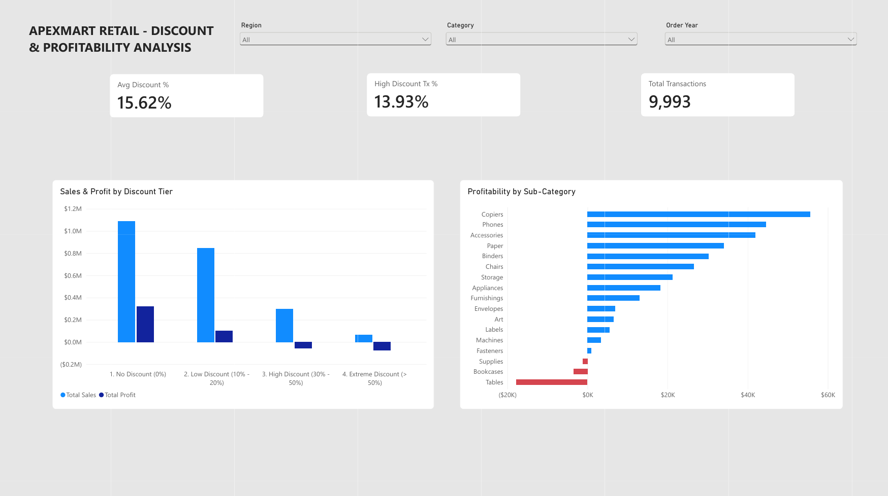

# ApexMart Retail Sales & Profitability Analysis

I analyzed **9,993 retail transactions** (5,009 orders) from ApexMart covering 2014 to 2017. The main goal was to figure out why overall profit margins were slipping even though annual sales kept growing.

**Tools used:** Excel, PostgreSQL (pgAdmin 4), Power BI Desktop

---

## What I Did

- **Data Cleaning (Excel & Power Query):** Checked all 24 columns for missing values and duplicates, converted `postal_code` to text so leading zeros wouldn't drop, and grouped discount rates into four tiers (`0%`, `10%–20%`, `30%–50%`, and `>50%`).
- **SQL Exploration (PostgreSQL):** Wrote queries using `CASE` statements and CTEs to break down regional margins, yearly trends, and loss-making sub-categories.
- **Dashboard & DAX (Power BI):** Built a 2-page interactive report with 7 DAX measures (`Total Sales`, `Total Profit`, `Profit Margin %`, `Total Orders`, `Total Transactions`, `Avg Discount %`, and `High Discount Tx %`). Every KPI card was cross-checked against my SQL query outputs to make sure the numbers matched.

---

## Dashboard

### Page 1: Executive Performance Overview


### Page 2: Discount & Profitability Analysis


---

## Key Findings

- **Sales grew, but margins dropped in 2017:** Total sales reached **$2.30M** with **$286.41K** in net profit (**12.47%** margin). Revenue peaked in 2017 at ~$0.73M, yet profit margin slipped from ~13.4% in 2016 to ~12.7% in 2017 due to heavier discounting.
- **30% is the breaking point for profit:** The average discount across all orders was **15.62%**, and **13.93%** of transactions had discounts of 30% or higher. Orders with `0%` to `20%` discounts stayed profitable, but once discounts hit `30%+`, transactions consistently lost money.
- **Central region underperforms on profit:** West and East generated the highest sales and profit. Central actually brought in more revenue than South (~$0.50M vs. ~$0.39M), but ended up with lower total profit because it gave out much steeper discounts.
- **Consumer & Corporate drive over 80% of sales:** Consumer (**$1.16M / 50.56%**) and Corporate (**$0.71M / 30.74%**) accounted for **81.30%** of total revenue, while Home Office made up the remaining **$0.43M (18.69%)**.
- **Losses come from just 3 sub-categories:** Out of 17 sub-categories, only three recorded a net loss: **Tables** (biggest loss), **Bookcases**, and **Supplies**. Tech items like **Copiers**, **Phones**, and **Accessories** carried most of the company's profit.

---

## Recommendations

1. **Cap standard discounts at 20%:** Stop running routine promos at 30% or higher and require manager sign-off for anything above 20%.
2. **Fix pricing or bundle loss-making furniture:** Review shipping costs and supplier margins for Tables and Bookcases, or bundle them with profitable items like Chairs instead of discounting them solo.
3. **Tighten discount rules in Central:** Align promo limits in the Central region with West and East so higher sales volume actually translates into profit.
4. **Focus cross-selling on Consumer & Corporate:** Target repeat buyers in these two segments with bundles that pair high-margin tech accessories with standard office supplies.

---

## Project Files

```text
├── Dashboard/
│   ├── ApexMart_Retail_Dashboard.pbix
│   └── ApexMart_Retail_Dashboard.pdf
├── Data/
│   └── apexmart_sales_cleaned.csv
├── Images/
│   ├── page1_executive_overview.png
│   └── page2_discount_profitability.png
├── SQL/
│   └── apexmart_exploratory_analysis.sql
└── README.md
